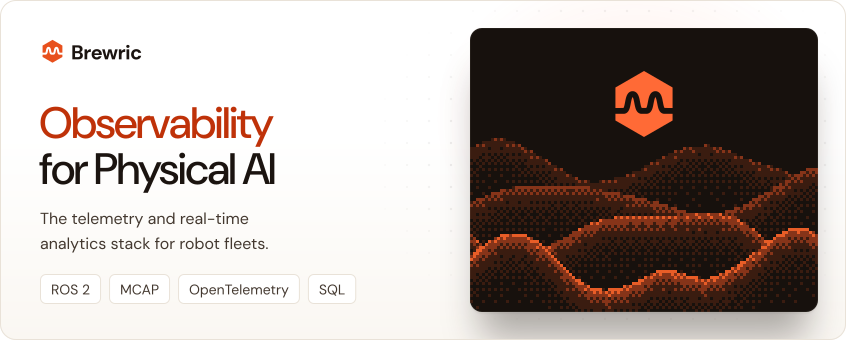
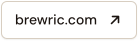

<!-- The Brewric organization page. tools/build.py draws the images in assets/; the benchmark numbers
     come from results/published/summary.json in Brewric/benchmarks. -->

  <a href="https://brewric.com">
    <picture>
      <source media="(prefers-color-scheme: dark)" srcset="assets/hero-dark.svg">
      
    </picture>
  </a>

  &nbsp;
  <a href="https://brewric.com"><picture><source media="(prefers-color-scheme: dark)" srcset="assets/button-website-dark.svg"></picture></a>&nbsp;
  <a href="https://github.com/Brewric/benchmarks"><picture><source media="(prefers-color-scheme: dark)" srcset="assets/button-benchmarks-dark.svg"></picture></a>&nbsp;
  <a href="https://brewric.com/#standard"><picture><source media="(prefers-color-scheme: dark)" srcset="assets/button-opal-dark.svg"></picture></a>

### What Brewric does

Robots record what they see and do, mostly as ROS 2 messages in MCAP files. Usually those files are
uploaded first and searched later, so finding out why a robot failed has to wait.

Brewric indexes robot data while it is being recorded. Robots stream the files they already write, and
Brewric turns each message into columns as it arrives. The whole fleet can be queried with SQL right away,
and every failure links to the exact moment in the sensor recording.

On top of that index is a console for watching a fleet, triaging incidents and finding what changed: a
model rollout, one aisle, one batch of batteries.

### What's open

<table>
<tr>
<td width="50%" valign="top">

<a href="https://brewric.com/#standard"><picture><source media="(prefers-color-scheme: dark)" srcset="assets/icon-opal-dark.svg"></picture></a>

**OPAL**, the Open Physical-AI Layer

Shared names for robot telemetry: which robot, what task, how it failed, who stepped in, which model was
running, and where the recording is. OPAL adds no new format. It sits on OpenTelemetry and MCAP, so data
captured once works in any tool. Version 0.1 is a draft.

[About the open standard](https://brewric.com/#standard)

</td>
<td width="50%" valign="top">

<a href="https://github.com/Brewric/benchmarks"><picture><source media="(prefers-color-scheme: dark)" srcset="assets/icon-benchmarks-dark.svg"></picture></a>

**Benchmarks**

Brewric next to the tools robotics teams use today: rosbags and Foxglove's MCAP toolchain for
recordings, and QuestDB, ClickHouse, InfluxDB 3 and TimescaleDB for time series. The scripts, raw
results and method are public, so anyone can rerun them.

[Brewric/benchmarks](https://github.com/Brewric/benchmarks)

</td>
</tr>
</table>

### Benchmark results

| Test | Brewric | Next best |
|:--|--:|--:|
| Turn ROS 2 recordings (MCAP) into queryable columns, on one core | 211 MB/s | 2.4 MB/s, rosbags |
| Time from a write to seeing it in SQL, under load (p99) | 14.7 ms | 38.4 ms, QuestDB |
| Load the TSBS devops data | 622K rows/s | 373K rows/s, QuestDB |
| Run the TSBS devops queries (geometric mean of medians) | 16.1 ms | 29.7 ms, QuestDB |

Every system ran alone on the same 4 vCPU cloud VM, with the same limits and its vendor's default settings.
Charts are at [brewric.com/benchmarks](https://brewric.com/benchmarks).

### Get in touch

If you run robots and want to see Brewric on your own data, write to
[hello@brewric.com](mailto:hello@brewric.com?subject=Brewric).

### Links

- **Website:** [brewric.com](https://brewric.com)
- **Benchmarks:** [charts](https://brewric.com/benchmarks) · [scripts and raw results](https://github.com/Brewric/benchmarks)
- **OPAL:** [brewric.com/#standard](https://brewric.com/#standard)
- **Email:** [hello@brewric.com](mailto:hello@brewric.com)

 

  <a href="https://brewric.com"><picture><source media="(prefers-color-scheme: dark)" srcset="assets/mark-dark.svg"></picture></a>

